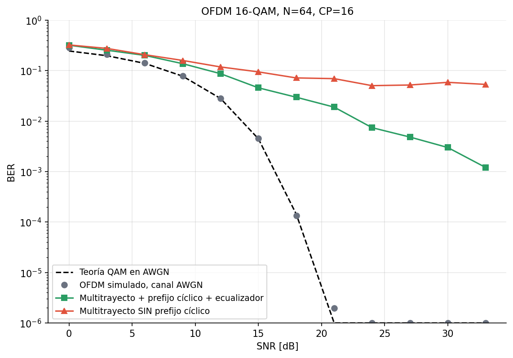
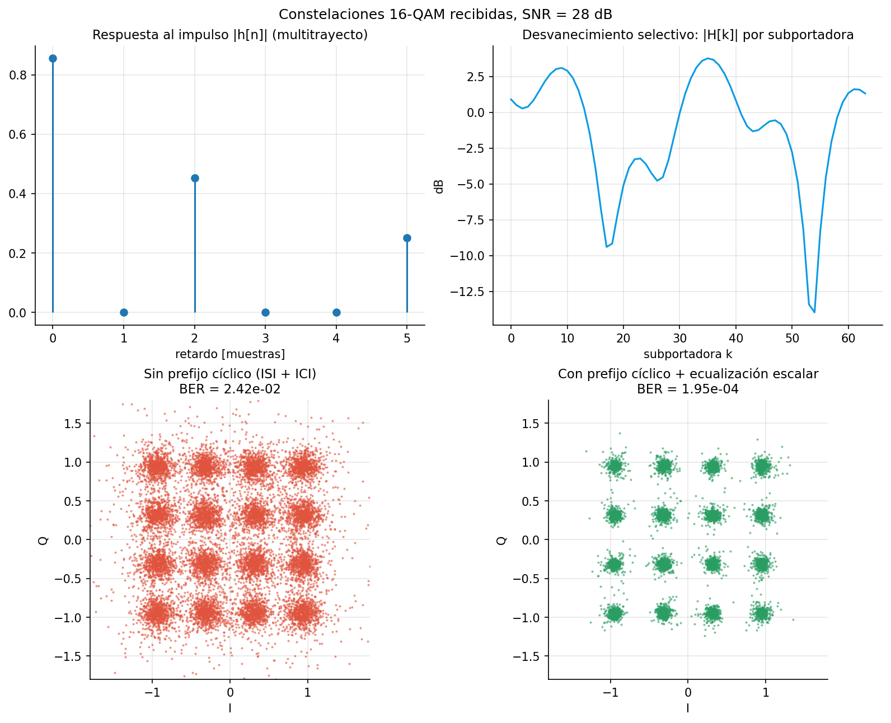

# Simulación de un sistema OFDM en Python

Proyecto universitario de **Teoría de Señales · Módulo OFDM**. Este repositorio convierte cada diapositiva del
*Marco Teórico: OFDM* en código y experimentos reproducibles: muestreo, DFT/FFT, ortogonalidad de subportadoras,
canal multitrayecto con ruido, prefijo cíclico y un transceptor OFDM completo con curvas de BER.

## Correspondencia diapositivas → código

| Diapositiva | Concepto | Módulo (`src/ofdm_sim/`) | Experimento | Figura (`results/`) |
|---|---|---|---|---|
| Portadora Única vs FDM | ISI en portadora única; OFDM la absorbe | `ofdm.py`, `channel.py` | `00_portadora_unica_vs_ofdm.py` | `00_portadora_unica_vs_ofdm.png` |
| Adquisición de Señales | Nyquist `fs ≥ 2B`, cuantización, `N = T·fs`, `Δf = fs/N` | `sampling.py` | `01_adquisicion_senales.py` | `01a…01c_*.png` |
| Análisis Matemático | DFT e IDFT | `dft.py` | `02_dft_vs_fft.py` | `02_dft_vs_fft.png` |
| Eficiencia Computacional | `O(N²)` vs `O(N log₂N)` | `dft.py` | `02_dft_vs_fft.py` | `02_dft_vs_fft.png` |
| Ortogonalidad en OFDM | `Δf = 1/T`, ICI, IFFT en vez de osciladores | `orthogonality.py` | `03_ortogonalidad.py` | `03a_*.png`, `03b_*.png` |
| Canales con Ruido | AWGN, desvanecimiento multitrayecto, prefijo cíclico | `channel.py`, `ofdm.py` | `04_canal_prefijo_ciclico.py` | `04_canal_prefijo_ciclico.png` |
| Diseño del Transceptor | Parámetros → Tx → Canal → Rx | `ofdm.py`, `link.py` | `05_ofdm_ber.py`, `06_demo_mensaje.py` | `05_ofdm_ber_16qam.png` |

## Instalación

```bash
git clone https://github.com/TU_USUARIO/ofdm-simulacion.git
cd ofdm-simulacion
python -m venv venv
source venv/bin/activate          # Windows: venv\Scripts\activate
pip install -r requirements.txt
```

## Uso

```bash
python run_all.py                       # todos los experimentos (genera results/*.png)
python run_all.py --quick               # versión rápida
python experiments/05_ofdm_ber.py --mod 64 --trials 60   # BER con 64-QAM
pytest -q                               # pruebas automáticas
```

## El transceptor (4 pasos de la última diapositiva)

1. **Parámetros** (`OFDMParams`): ancho de banda `B`, tamaño de FFT `N`, `Ts = 1/B`, `Δf = B/N = 1/T`.
2. **Transmisor**: bits → mapeo M-QAM (Gray) → **IFFT** → inserción del **prefijo cíclico**.
3. **Medio físico**: convolución con canal multitrayecto (Rayleigh) + ruido **AWGN**.
4. **Receptor**: descartar prefijo → **FFT** → **ecualización escalar** `Y[k]/H[k]` → demodulación → BER.

## Resultados principales

Salida de `05_ofdm_ber.py` (16-QAM, N = 64, CP = 16):



- El OFDM simulado sobre AWGN **coincide con la BER teórica** de la QAM, lo que valida la implementación.
- Con **prefijo cíclico**, el canal multitrayecto se reduce a una ganancia compleja por subportadora y
  basta un ecualizador de un solo coeficiente.
- **Sin prefijo cíclico** aparecen ISI e ICI y la BER se estanca en un piso de ≈ 5·10⁻².
- La BER en canal con desvanecimiento no alcanza a la de AWGN porque las subportadoras en desvanecimiento profundo
  dominan los errores (ecualización zero-forcing, sin codificación de canal).



## Estructura

```
src/ofdm_sim/   sampling.py · dft.py · orthogonality.py · ofdm.py · channel.py · link.py
experiments/    00 … 06 (un script por bloque de diapositivas)
tests/          pruebas con pytest (también se ejecutan en GitHub Actions)
results/        figuras generadas
```

## Referencias de imágenes de las diapositivas

- iStock, *Abstract visualization of AI processing big data* — https://media.istockphoto.com/id/2245670697/
- BirdRF, *Radio Frequency Spectrum Visualization* — https://birdrf.com/

## Autores

_Agrega aquí los nombres del equipo, el curso y la universidad._
